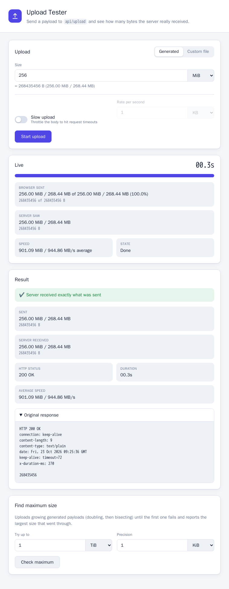

# upload-tester

A small web app for testing upload limits, e.g. of reverse proxies, gateways or WAFs in front of it.
The server has no size limit of its own and answers every upload with the number of bytes it received.



More screenshots: [screenshots/README.md](screenshots/README.md).

## Features

- Upload a generated payload of any size, in decimal (B, KB, MB, GB, TB) or binary (KiB, MiB, GiB, TiB) units, or send a custom file.
- Live panel with progress bar, bytes sent by the browser, bytes actually seen by the server, speed and a stopwatch that stops when the request ends. It stays open afterwards, so you can see at which byte count an upload stopped.
- Slow upload: streams the body at a fixed rate (e.g. 1 KB/s) to hit request and body timeouts. Browsers only allow streamed request bodies over HTTP/2 or HTTP/3, so use the HTTPS port (8443, self-signed certificate, accept the browser warning once) or a TLS proxy in front.
- Check maximum: uploads growing payloads (doubling, then bisecting) until one fails and reports the largest accepted size.
- The server response is shown unchanged, with human-readable sizes next to it. The original response (status, headers, body) is available in a collapsed section.

## Run with Docker

```bash
docker run --rm -p 8080:8080 -p 8443:8443 ruepp/upload-tester:latest
```

Then open <http://localhost:8080>. For slow uploads open <https://localhost:8443> instead (see below).

## Run with Docker Compose

```yaml
services:
  upload-tester:
    image: ruepp/upload-tester:latest
    container_name: upload-tester
    restart: unless-stopped
    ports:
      - "8080:8080"
      - "8443:8443"
    environment:
      PORT: 8080
      HTTPS_PORT: 8443
```

```bash
docker compose up -d
```

## API

Paths below are relative to `BASE_PATH`.

| Endpoint | Description |
| --- | --- |
| `POST /api/upload` | Reads the whole body without storing it and answers `200` with only the received byte count as plain text, e.g. `1048576`. |
| `GET /api/upload/:id/progress` | Bytes received so far for an upload that sent the header `X-Upload-Id: <id>`. Kept for 60 seconds after the upload ends. |
| `GET /api/health` | Health check. |
| `GET /api/info` | `{"httpsPort": 8443}`; used by the UI to link to the HTTPS version. |

```bash
head -c 1G /dev/zero | curl -T - -X POST http://localhost:8080/api/upload
```

## Configuration

| Variable | Default | Description |
| --- | --- | --- |
| `PORT` | `8080` | HTTP port. |
| `BASE_PATH` | `/` | Path the UI and API are served under, and only there, e.g. `/upload/tester`. `/upload/tester` redirects to `/upload/tester/`. |
| `HTTPS_PORT` | `8443` | HTTPS/HTTP2 port with a self-signed certificate created at startup. `0` disables it. |

## Development

Requires Node.js 24 or newer.

```bash
npm ci
npm run build      # client (Vite) and server (tsc) into dist/
npm start          # serves the UI and API on http://localhost:8080
npm test           # unit tests
npm run typecheck
```

For frontend work run `npm run dev` for the server and `npx vite` for the UI with hot reload; Vite proxies `/api` to port 8080.
