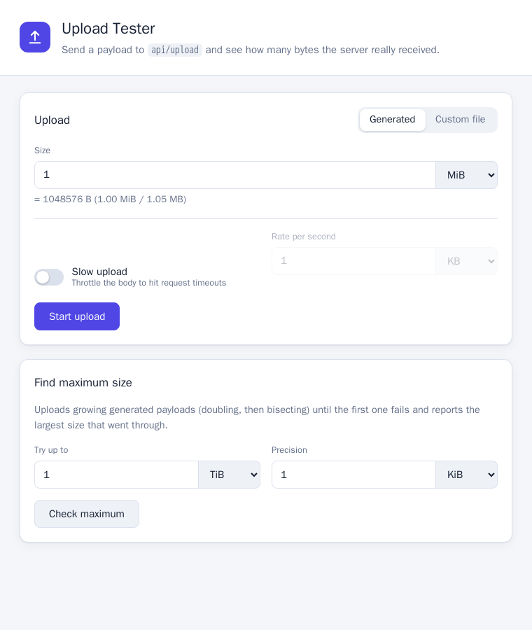
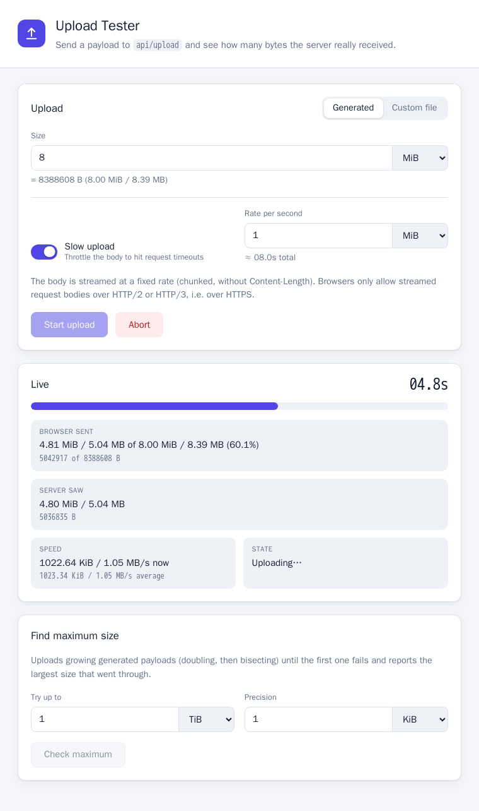
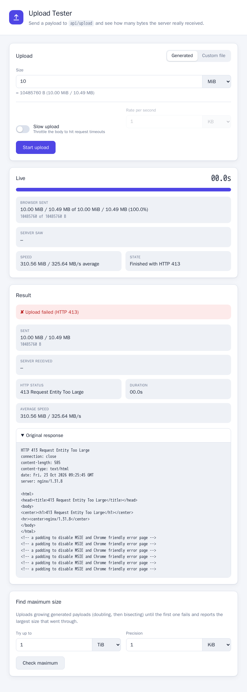
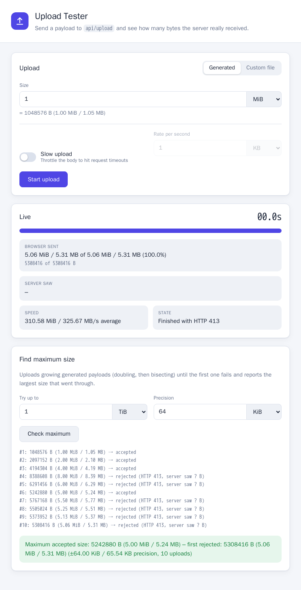
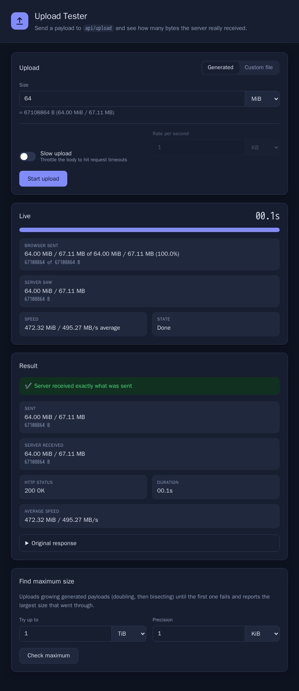
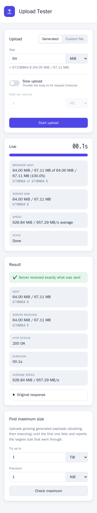

# Screenshots

Screenshots of the UI. The upload size is chosen in decimal (KB, MB, ...) or binary (KiB, MiB, ...) units; exact bytes
are always shown below the human-readable values.

## Upload form

Generated payload or custom file, optional slow upload, and the "Find maximum size" check below.

## Successful upload

Live panel (progress, what the browser sent, what the server saw, speed, stopwatch) and the result with the server's
original response expanded. The server answers with nothing but the received byte count.

## Slow upload

A 8 MiB body streamed at 1 MiB/s, shown mid-upload: current and average speed, bytes sent by the browser versus bytes
seen by the server, and the stopwatch. Streamed bodies need HTTPS (HTTP/2), here the built-in port 8443.

## Upload rejected by a proxy

The same app behind nginx with `client_max_body_size 5m`. A 10 MiB upload fails with HTTP 413, the original response
of the proxy is shown, and the server never saw a byte.

## Find maximum size

Behind the same 5 MB nginx limit: doubling from 1 MiB, then bisecting, reports 5.00 MiB as the largest accepted size.

## Dark mode

The UI follows the system's light or dark setting.

## Mobile

Fields and buttons stack on narrow screens.
